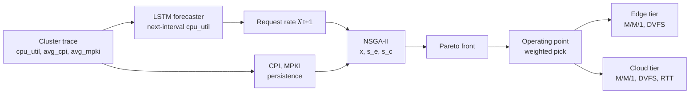
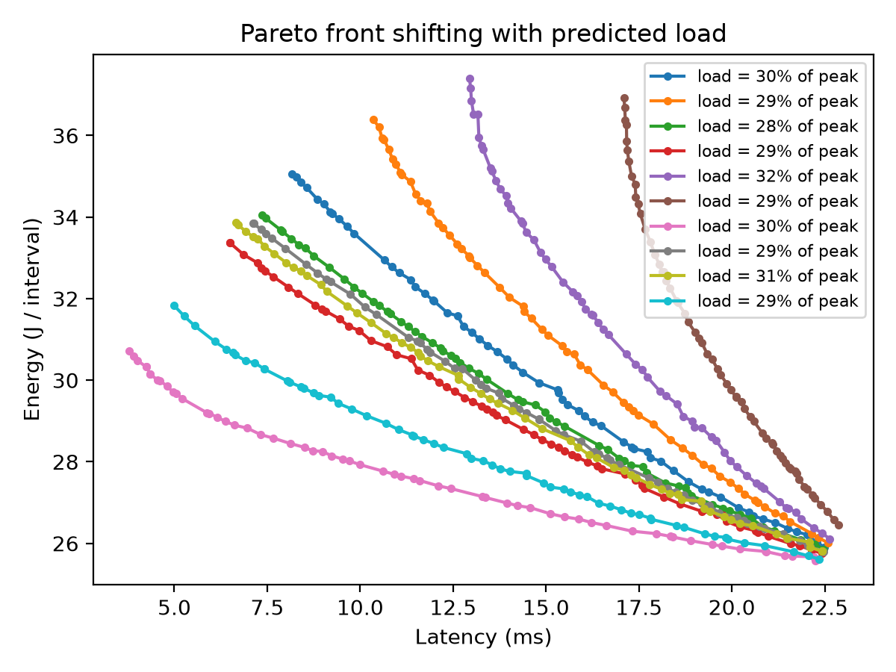
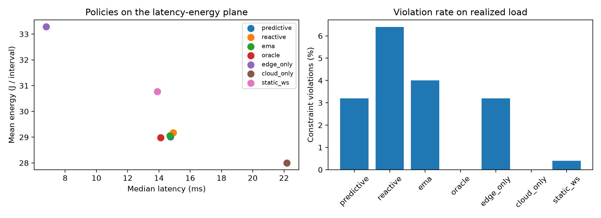
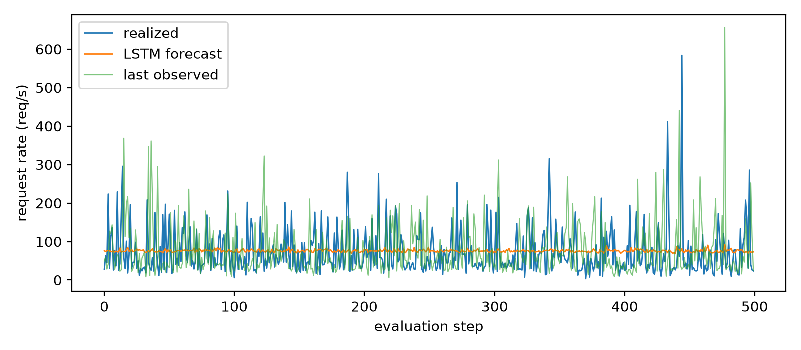

# Predictive Multi-Objective Task Offloading for Edge-Cloud Systems

A forecast-then-optimize framework: an LSTM predicts next-interval load, and NSGA-II computes the latency-energy Pareto front over offloading and frequency decisions before the load arrives. Decisions are scored on the load that actually occurred, so forecast error shows up as constraint violations.

> The hardware model is illustrative, not measured. The results describe the behavior of the framework, not absolute numbers for specific hardware.

## 1. Motivation

Edge nodes respond quickly at low load but saturate under bursts. Cloud tiers scale but add network delay and transmission energy. Reactive policies act only after load has shifted. This project measures how much a load forecast changes the latency-energy-feasibility tradeoff, and separates the value of the forecast from the value of multi-objective optimization.

## 2. System overview



| Module | File | Role |
|---|---|---|
| Forecasting | `Training.py` | LSTM, time-series CV, Optuna tuning |
| Environment and optimizer | `PymooProblemSolver.py` | Tier model, NSGA-II problem |
| Experiments | `run_experiment.py`, `run_benchmark.py` | Sanity sweep, baselines, figures |

## 3. Workload forecasting

- Input: sliding window of `cpu_util`, `avg_cpi`, `avg_mpki` (about 1.5M rows). Target: next-step `cpu_util`.
- Chronological split with the final 15% held out as a test set. The scaler is fit on training rows only, per fold.
- Expanding-window `TimeSeriesSplit` cross-validation. Hyperparameters (window length, hidden size, layers, dropout, learning rate, weight decay) are tuned with Optuna (TPE sampler, median pruning).

Test-set one-step MSE (scaled units):

| Forecaster | MSE |
|---|---|
| Persistence (previous value) | 0.0126 |
| EMA of the input window (alpha = 0.2) | 0.0075 |
| Tuned LSTM | **0.0064** |

The LSTM improves on persistence by about 49% and on the EMA by about 15%. The series is highly bursty, and the learned forecast is close to flat (Section 7), so much of this gain reflects smoothing rather than burst prediction.

## 4. Environment model

**Load mapping.** The trace has no request counts, so request rate is assumed proportional to utilization and rescaled so that the reference peak load is 1.3x edge capacity (reference utilization: 95th Percentile):

$$\hat\lambda_{t+1} = \frac{\hat u_{t+1}}{u_{ref}}\,\lambda_{peak}$$

**Service rate.** For tier *i* with $n_i$ cores, maximum clock $f_{max,i}$, frequency scale $s_i$, instructions per request $I$ and trace CPI (floored to avoid zero-CPI idle samples giving infinite capacity):

$$\mu_i = \frac{n_i\, f_{max,i}\, s_i}{I\cdot \mathrm{CPI}\cdot \gamma_i}$$

where $\gamma_i$ is a CPI factor (the cloud has better cores and caches). $I$ is calibrated so the edge saturates near 200 req/s at full frequency ($I \approx 3.7\times10^{8}$, reference CPI $\approx 0.136$).

**Load split.** With offload fraction $x\in[0,1]$: $\lambda_c = x\hat\lambda$, $\lambda_e=(1-x)\hat\lambda$.

**Latency** (M/M/1 per tier):

$$W_e=\frac{1}{\mu_e-\lambda_e},\qquad W_c=T_{rtt}+\frac{D}{B}+\frac{1}{\mu_c-\lambda_c},\qquad L=(1-x)W_e+xW_c$$

**Power** (idle, DVFS dynamic, memory):

$$P_i = P_{idle,i} + \kappa_i\,(f_{max,i}s_i)^{\alpha_i}\,\rho_i + \lambda_i\,\frac{I}{1000}\,\mathrm{MPKI}\,E_{miss}$$

with $\alpha\approx2$ (edge) and $\alpha\approx3$ (cloud).

**Energy** over an interval $\Delta t$ includes transmission:

$$E = \big[P_e + P_c + \lambda_c P_{tx}\tfrac{D}{B}\big]\Delta t$$

At full frequency the model gives edge latency of about 7 ms at 30% utilization and 52 ms at 90%, against a cloud latency of about 22 ms, so the two tiers cross and the tradeoff is non-trivial.

## 5. Multi-objective optimization

Decision vector $\mathbf{z}=(x,\,s_e,\,s_c)$:

$$\min_{\mathbf z}\ \big(L(\mathbf z),\ E(\mathbf z)\big)\quad \text{s.t.}\quad \lambda_e\le\rho_{max}\mu_e,\ \ \lambda_c\le\rho_{max}\mu_c,\ \ \rho_{max}=0.9$$

NSGA-II (`pymoo`) returns a non-dominated front for each interval. One operating point is selected by a normalized weighted sum (equal weights on latency and energy).



The fronts are curved and shift with predicted load: higher load moves the front up and to the right.

## 6. Evaluation protocol

Each policy decides using its own input, and every decision is scored on the realized next-interval load. 500 evaluation points are spread uniformly across the held-out test set.

| Policy | Decision |
|---|---|
| Predictive | NSGA-II on the LSTM forecast |
| Reactive | NSGA-II on the last observed load (isolates the value of the forecast) |
| EMA | NSGA-II on an exponential moving average of the window (isolates the value of smoothing) |
| Oracle | NSGA-II on the true next load (upper bound) |
| Edge-Only | x = 0, s = 1 |
| Cloud-Only | x = 1, s = 1 |
| Static | x = 0.5, s = 1 |

## 7. Results

| Policy | Median latency (ms) | Mean energy (J / interval) | Constraint violations |
|---|---|---|---|
| **Predictive** | 14.7 | 29.01 | 3.2% (16 / 500) |
| Reactive | 14.9 | 29.17 | 6.4% (32 / 500) |
| EMA | 14.7 | 29.06 | 4.0% (20 / 500) |
| Oracle | 14.1 | 28.99 | 0.0% |
| Edge-Only | 6.8 | 33.29 | 3.2% (16 / 500) |
| Cloud-Only | 22.2 | 28.00 | 0.0% |
| Static (x = 0.5) | 13.9 | 30.76 | 0.4% (2 / 500) |

A violation means the realized load exceeded $\rho_{max}$ on at least one tier under the chosen decision. Mean and tail latency are not reported because saturated intervals return very large clipped values that dominate those statistics. Violation rate and median latency are the primary measures.



**Findings**

1. **Forecast vs reactive.** Planning on the LSTM forecast halves constraint violations relative to planning on the last observed load (3.2% vs 6.4%), at similar median latency and energy.
2. **Forecast vs smoothing.** The EMA planner has 4.0% violations against 3.2% for the LSTM. At 500 evaluation points this gap is small, and no significance test was run, so it should not be read as a demonstrated advantage. Part of the gain over the reactive baseline comes from stabilizing the load estimate.
3. **Gap to the oracle.** The oracle matches the predictive controller's energy and median latency but has no violations, so the remaining gap comes from forecast error on burst intervals.
4. **Fixed policies bracket the tradeoff.** Edge-Only has the lowest latency but uses 15% more energy than the predictive controller. Cloud-Only has the lowest energy but about 50% higher median latency. A static 50/50 split has fewer violations than the predictive controller but uses about 6% more energy.
5. **Offloading behavior.** The predictive controller offloads a mean fraction of 0.41 of requests per interval (0.42 weighted by load). Offloading is only weakly correlated with realized load (r = 0.08), because the forecast is close to flat.



## 8. Limitations

- **The forecast is nearly flat.** The LSTM tracks the typical load level but not individual bursts, so the controller mostly plans around a typical load. The benefit over the reactive baseline comes partly from a more stable load estimate.
- **No statistical testing.** Differences between Predictive, EMA and Reactive in violation counts come from a single run of 500 evaluation points with no confidence intervals.
- **Planning has no safety margin.** The optimizer operates close to the utilization limit, so under-forecast bursts cause violations. Planning on an inflated forecast would trade energy for robustness. This is not evaluated here.
- Request rate is assumed proportional to `cpu_util`, and instructions per request is constant.
- CPI and MPKI for the next interval use the last observed values. Only `cpu_util` is forecast.
- Hardware parameters ($\kappa$, RTT, bandwidth, $E_{miss}$, core counts) are illustrative.
- Each tier is an aggregated M/M/1 queue. M/M/k, multiple edge and cloud nodes, and testbed validation are future work.

## 9. Reproduce

```bash
pip install numpy pandas scikit-learn torch optuna pymoo matplotlib joblib tabulate
python Training.py        # train, tune, save artifacts
python run_experiment.py  # sanity sweep and short rolling run
python run_benchmark.py   # baselines, tables, figures -> results/
```# MultiObjective_Optimisation_With_LSTM_Workload_Prediction_For_Cloud_Edge_Systems
# MultiObjective_Optimisation_With_LSTM_Workload_Prediction_For_Cloud_Edge_Systems
